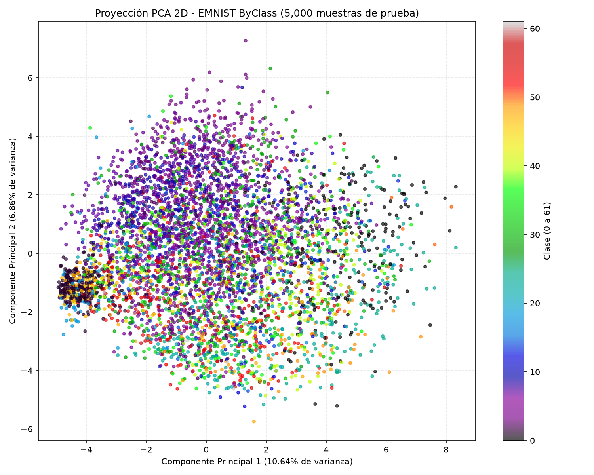
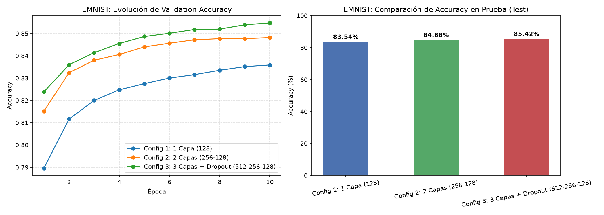
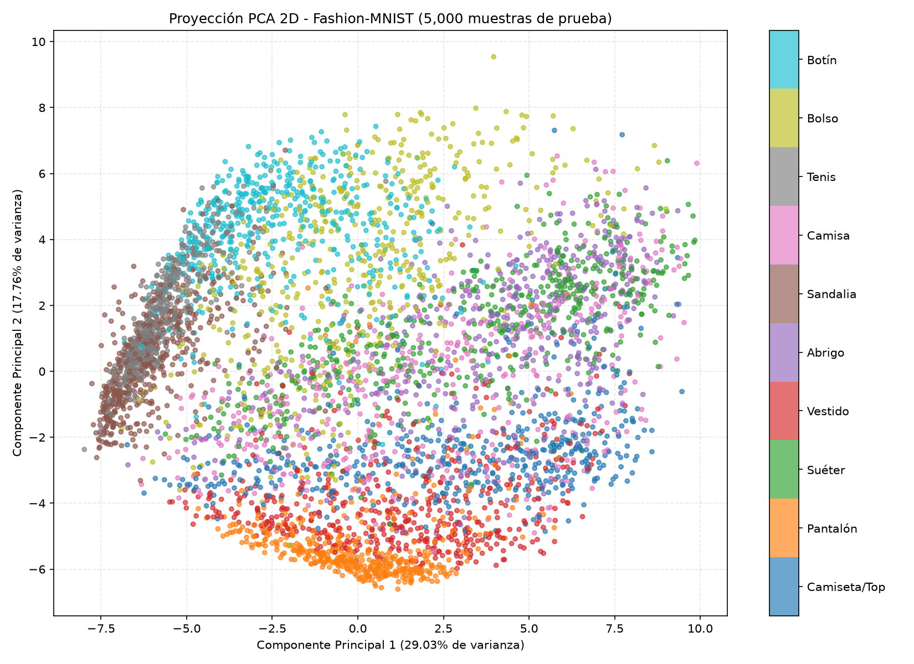
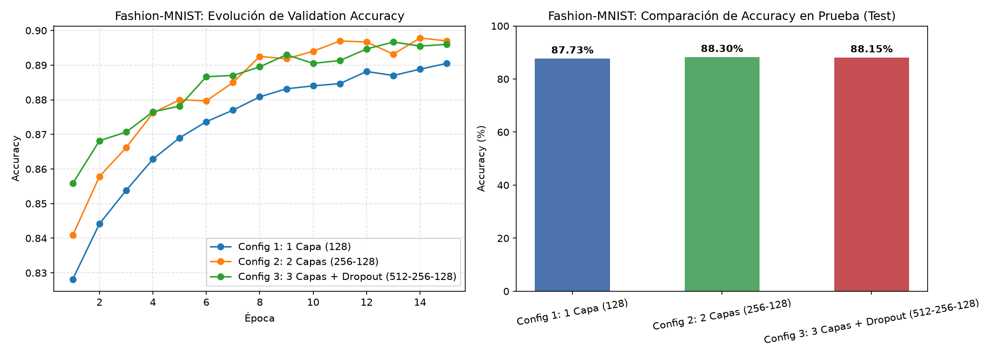

# Clasificación de Imágenes: EMNIST ByClass y Fashion-MNIST

Proyecto de clasificación supervisada utilizando redes neuronales densas (MLP) en TensorFlow/Keras y análisis exploratorio mediante reducción de dimensionalidad con PCA (2D).

## Estructura del Proyecto

- `EMNIST/emnist.py`: Carga, preprocesamiento, proyección PCA y entrenamiento de 3 arquitecturas sobre `emnist/byclass` (62 clases).
- `Fashion_MNIST/fashion_mnist.py`: Carga, preprocesamiento, proyección PCA y entrenamiento de 3 arquitecturas sobre `fashion_mnist` (10 clases).
- `Resultados/`: Gráficas de muestras, proyecciones PCA 2D, curvas de aprendizaje y tablas CSV con las métricas finales.

## Metodología Aplicada

1. **Preparación de datos:** Extracción de los conjuntos de entrenamiento y prueba desde `tensorflow_datasets` (corrigiendo la orientación mediante transpuesta en EMNIST).
2. **Normalización:** Escalamiento de píxeles de `[0, 255]` al rango `[0, 1]` (`float32`).
3. **Flatten:** Conversión de cada imagen de `28 × 28` píxeles a un vector unidimensional de `784` características.
4. **Visualización PCA 2D:** Proyección de 5,000 muestras de prueba sobre los 2 primeros componentes principales.
5. **Modelado:** Evaluación comparativa de tres arquitecturas progresivas (`Dense` con activación `ReLU` y salida `Softmax`) entrenadas con optimizador `Adam` y función de pérdida `sparse_categorical_crossentropy`.

---

## Resultados: EMNIST ByClass (62 clases)

| Configuración | Train Accuracy | Val Accuracy | Test Accuracy |
| :--- | :---: | :---: | :---: |
| **Config 1:** 1 Capa (`128`) | 84.00% | 83.59% | 83.54% |
| **Config 2:** 2 Capas (`256-128`) | 86.12% | 84.82% | 84.68% |
| **Config 3:** 3 Capas + Dropout (`512-256-128`) | 83.91% | 85.47% | **85.42%** |

- **Hallazgo:** Aunque la Configuración 2 alcanzó mayor exactitud en entrenamiento (`86.12%`), la **Configuración 3 con Dropout (0.3)** generalizó mejor en datos no vistos (`85.42%` en Test), evitando el sobreajuste ante la alta complejidad de 62 clases.

---

## Resultados: Fashion-MNIST (10 clases)

| Configuración | Train Accuracy | Val Accuracy | Test Accuracy |
| :--- | :---: | :---: | :---: |
| **Config 1:** 1 Capa (`128`) | 91.64% | 89.05% | 87.73% |
| **Config 2:** 2 Capas (`256-128`) | 93.12% | 89.70% | **88.30%** |
| **Config 3:** 3 Capas + Dropout (`512-256-128`) | 89.98% | 89.60% | 88.15% |

- **Hallazgo:** Al tratarse de 10 categorías visuales bien definidas, la **Configuración 2 (`256-128`)** obtuvo el mejor rendimiento tanto en validación (`89.70%`) como en prueba (`88.30%`), superando ligeramente a la red más profunda con Dropout.

